# Lisufit PDV — Totem de autoatendimento

Sistema de **totem de autoatendimento e PDV** feito para a **Lisufit**, loja de suplementos com um Empório (salgados, refeições, shakes, sucos e cafés). Está **em uso na loja**: o cliente monta o pedido na tela de toque, paga no PIX ou no cartão direto na maquininha, e o pedido sai impresso para a cozinha.

Funciona **100% offline** (a internet só é usada pela maquininha), em um PC com Windows e tela de toque, em modo quiosque.

**Stack:** Electron · JavaScript puro (sem framework) · HTML/CSS · banco local em JSON · API Orders do Mercado Pago (Point) · Playwright (testes ponta a ponta) · PowerShell (instalador)

### Destaques técnicos
- **Pagamento integrado à maquininha** Mercado Pago Point (API Orders, modo PDV): o valor vai sozinho para a maquininha e o totem confirma quando o pagamento é aprovado. Os gateways são **plugáveis** (um arquivo por provedor: Mercado Pago, Stone, simulador e manual).
- **Offline-first:** banco em JSON com gravação segura, backup diário automático, restauração pela tela e registro de erros.
- **Segurança:** PIN guardado só como hash (scrypt), bloqueio depois de 5 tentativas erradas, preço sempre recalculado no processo principal (nunca confia no valor vindo da tela) e ponte `preload` isolada entre a interface e o sistema.
- **Catálogo sincronizado pelo Git:** produtos novos sobem pelo repositório e entram na loja com foto, sem sobrescrever os preços que a loja mudou.
- **Atualização em 1 clique** pelo painel, com volta para a versão anterior.
- **Instalador para PC zerado** em PowerShell: instala Git, Node e as dependências, cria atalhos e configura o Windows como totem.
- **Teclado virtual próprio** (o teclado do Windows não abre em modo quiosque), com acentos e layout numérico.
- **10 testes ponta a ponta** que abrem o app de verdade (Electron + Playwright) e passam pelos fluxos de venda, pagamento, catálogo, caixa e indicadores.

## Telas

### Totem (cliente)

**Tela inicial.** É o que o cliente vê ao chegar. Um toque abre o cardápio. Depois de um tempo parado, o totem volta sozinho para esta tela e limpa o pedido.

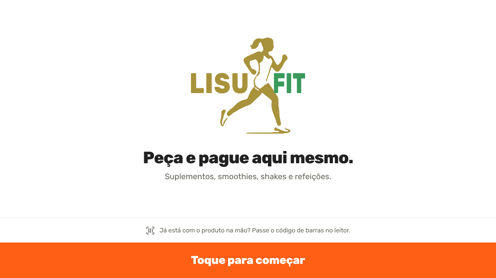

**Catálogo.** As categorias ficam na lateral, agrupadas por seção (Suplementos e Empório). Os produtos aparecem com foto e preço, e o botão "+" adiciona ao pedido. Embaixo ficam o carrinho, com a quantidade de itens, e o total com o botão de finalizar. Categoria sem produto disponível não aparece.

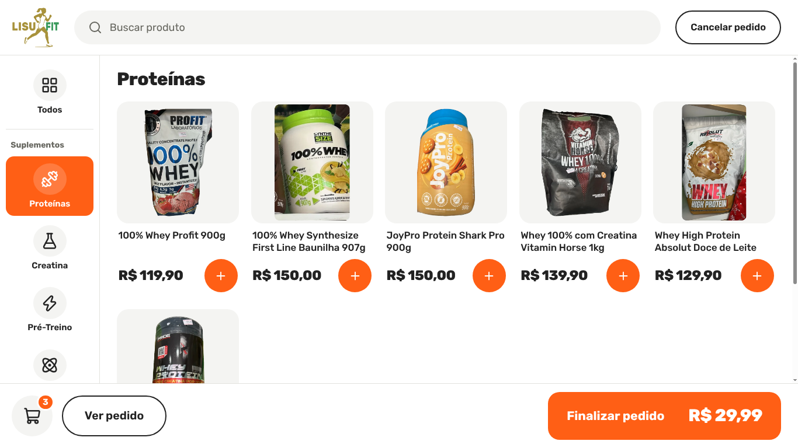

**Monte do seu jeito.** Produtos com variações (sabor, frutas, adicionais) abrem esta janela. Cada opção mostra os ingredientes e pode ter preço extra. O botão só libera quando as escolhas obrigatórias foram feitas, e o preço é atualizado na hora.

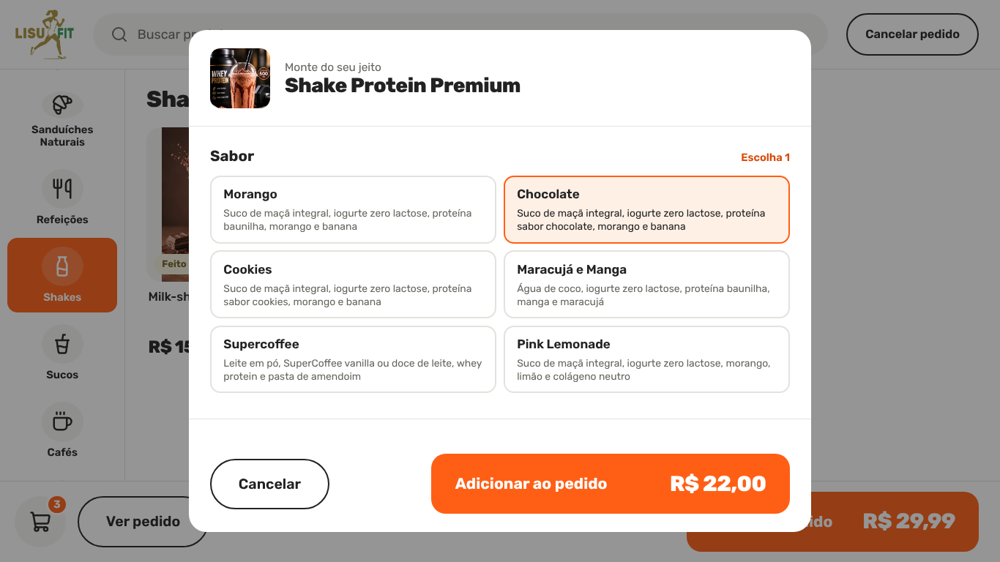

**Busca com teclado na tela.** O totem não tem teclado físico, então o sistema tem um teclado próprio que abre ao tocar em qualquer campo. Ele tem acentos (´ ~ ^), Ç, símbolos e um modo numérico para preços e PINs, e a lista filtra enquanto o cliente digita.

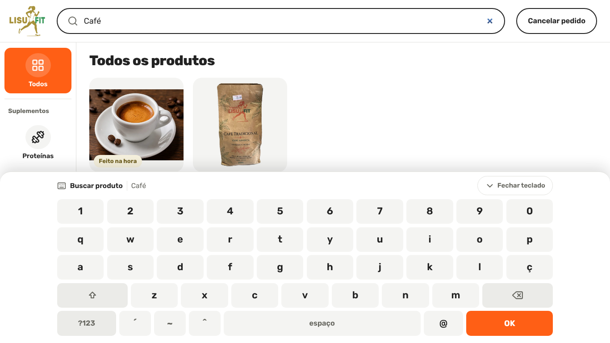

**Forma de pagamento.** O cliente escolhe PIX, Cartão ou Pagar no caixa. O topo mostra em que etapa ele está (Pedido, Pagamento, Pronto) e o total. A loja pode desligar qualquer uma das formas nas configurações.

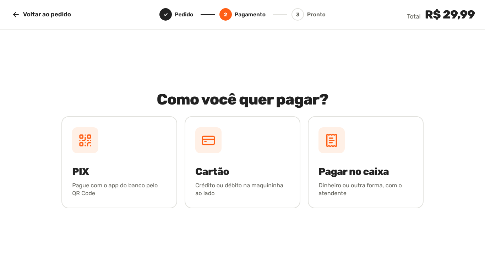

**PIX.** O QR Code é gerado com o valor exato da compra, no padrão do Banco Central (PIX Copia e Cola). Com a maquininha integrada, o QR aparece na própria maquininha e a confirmação é automática.

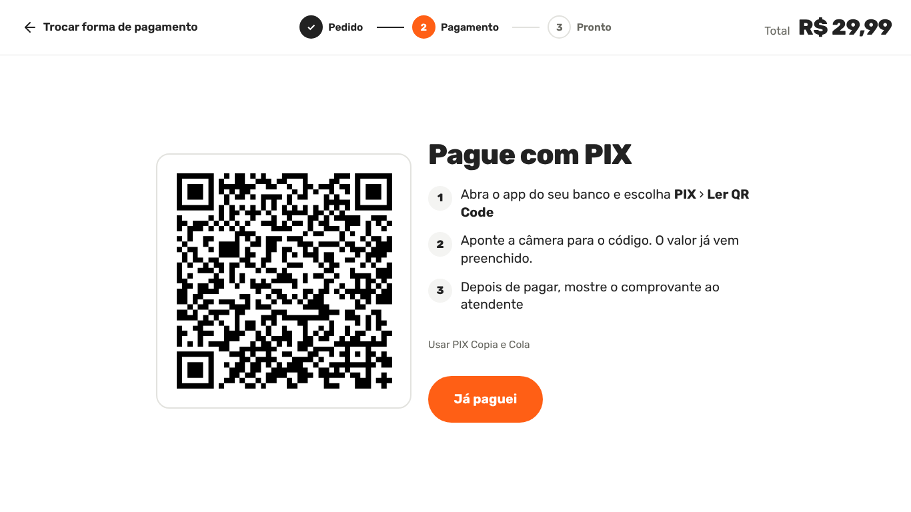

**Cartão na maquininha.** O valor é enviado direto para a maquininha ao lado do totem. O cliente só aproxima ou insere o cartão. O totem consulta o pagamento a cada poucos segundos e confirma sozinho, com tempo limite e opção de tentar de novo se for recusado.

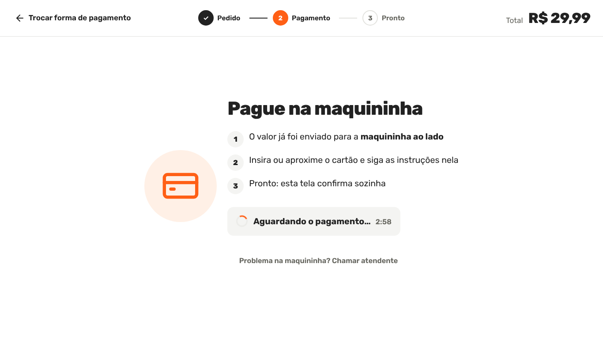

### Painel da loja (admin)

O painel abre com o PIN do admin (5 toques no logo ou Ctrl+Shift+A). Com o PIN de um atendente, ele mostra só as vendas e o fechamento do caixa.

**Produtos.** Lista com filtros por categoria e situação, preço editável direto na tabela, chave para mostrar ou esconder do totem, ações em massa, duplicar produto e importação/exportação por planilha Excel. Os avisos no topo mostram produtos com preço de exemplo e produtos ainda sem preço, que ficam fora do totem.

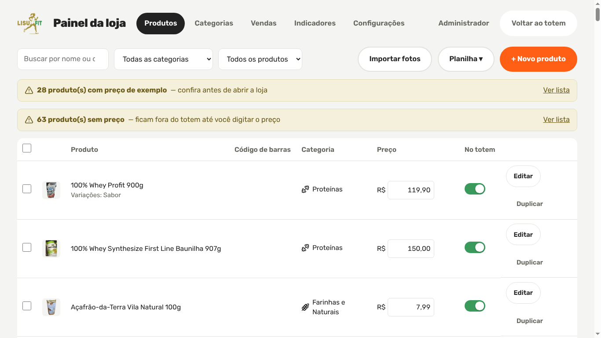

**Categorias.** Cada categoria tem seção, ícone e ordem no totem. Renomear uma categoria atualiza todos os produtos dela.

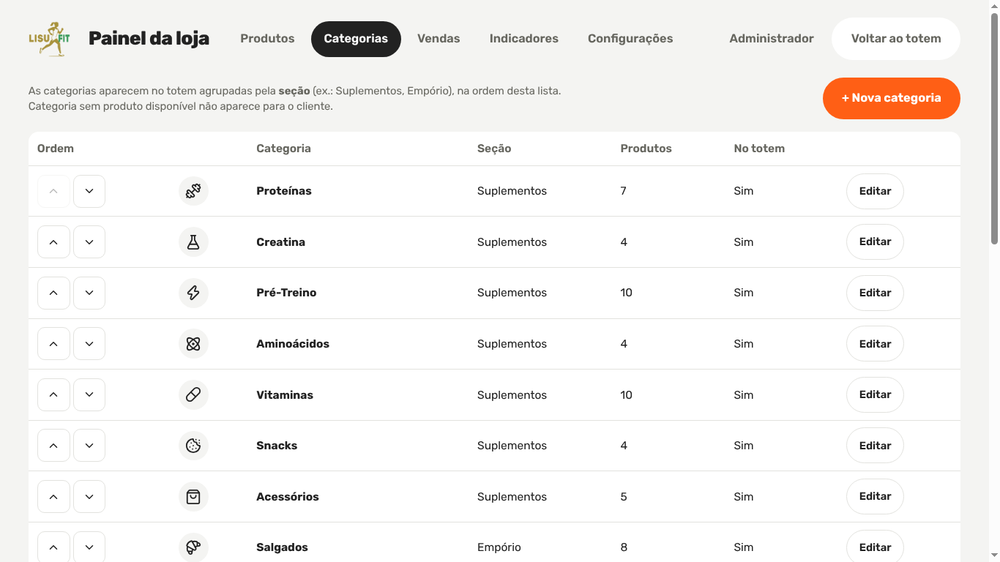

**Vendas.** Mostra os totais do período (faturamento, ticket médio, PIX, cartão, balcão e dinheiro), os pedidos que esperam pagamento no caixa, os mais vendidos e a lista de vendas com reimpressão e cancelamento. Daqui saem a planilha do período, a tela de pedidos da cozinha e o fechamento do caixa.

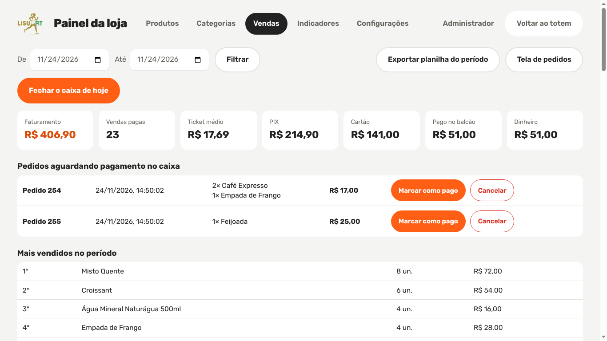

**Receber no balcão.** Para o pedido "pagar no caixa", o atendente escolhe como o cliente pagou. No dinheiro, ele digita o valor recebido e o troco é calculado. Fica registrado quem recebeu.

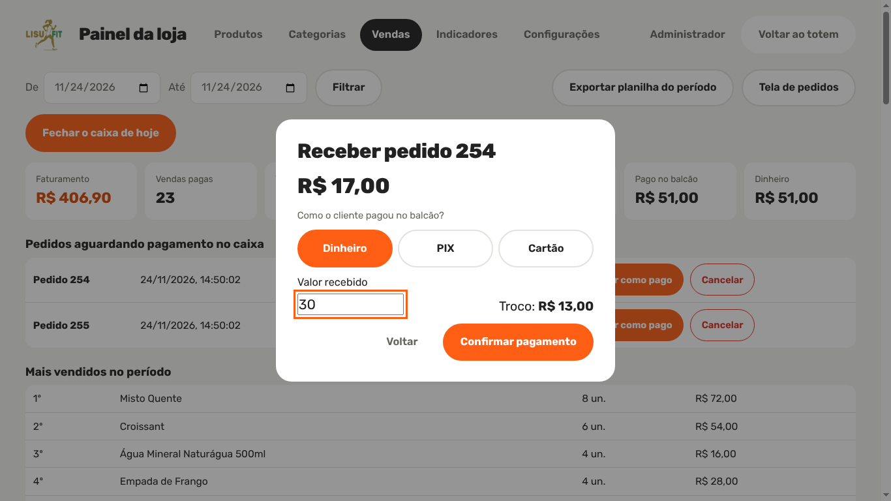

**Indicadores.** Faturamento, vendas e ticket médio comparados ao período anterior, cancelamentos, lucro bruto e margem (com o custo cadastrado) e tempo médio de preparo. O gráfico mostra as entradas por dia, e a tabela traz o fluxo de caixa por forma de pagamento.

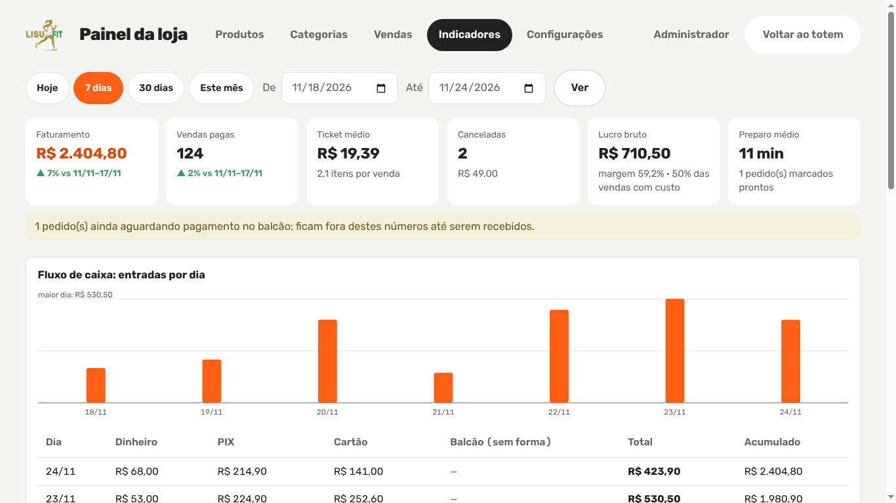

**Fluxo de caixa e vendas por hora.** O fluxo de caixa diário traz o acumulado, seguido das entradas por forma de recebimento, das vendas por hora (para ver os horários de pico), do faturamento por seção e categoria e do ranking dos mais vendidos com o lucro de cada item.

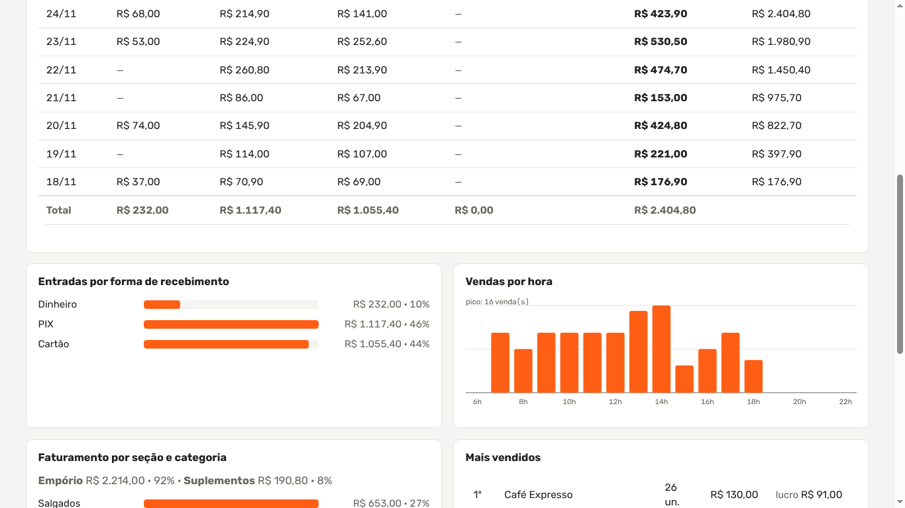

**Configurações.** Dados da loja que saem no cupom, formas de pagamento do totem, escolha do gateway (aqui, Mercado Pago Point integrado, com Access Token e número de série da maquininha, mais o botão Testar conexão) e a chave PIX. Mais abaixo ficam impressora, PINs e atendentes, backup, modo teste e atualização do sistema.

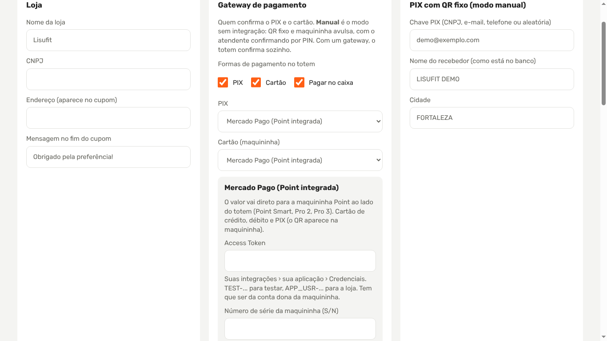

### Tela de pedidos (cozinha)

Abre numa segunda tela ou TV para quem prepara. Os pedidos pagos que têm item feito na hora aparecem com a senha, o nome do cliente e as opções escolhidas. O cartão muda de cor conforme o tempo de espera (amarelo aos 6 minutos, vermelho aos 10). **Pronto** chama a senha com som e a coloca em "Prontos para retirar".

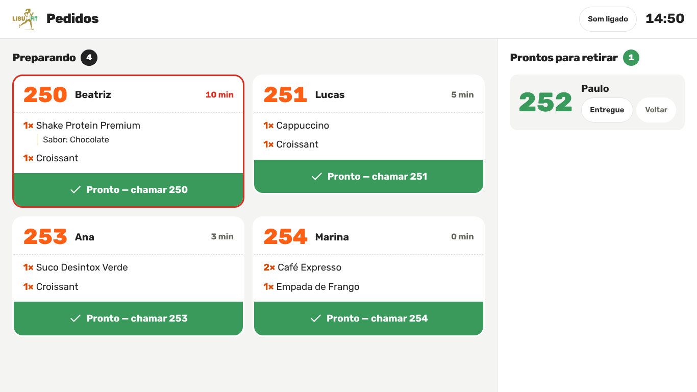

> As telas foram capturadas com dados de demonstração (vendas fictícias), sem dados reais da loja.

---

## Documentação técnica

## O que ele faz
- **Catálogo na tela de toque** com categorias, busca e fotos
- **Leitor de código de barras USB**: passou o produto, entra no carrinho (em qualquer tela do cliente)
- **3 formas de pagamento**: PIX (QR Code gerado com o valor exato), cartão na maquininha ao lado, ou "pagar no caixa" (gera nº de pedido)
- **Confirmação por PIN do atendente** para PIX e cartão (pode desligar nas configurações)
- **Cupom não fiscal** impresso na impressora térmica escolhida
- **Controle de estoque** (baixa automática, alerta de estoque baixo, produto esgotado some do totem)
- **Categorias por seção** (Suplementos, Empório...): cadastro no painel com ícone, ordem e opção de ocultar
- **Itens feitos na hora** (smoothies, shakes): produto sem controle de estoque, nunca fica esgotado
- **Variações de produto** (sabor, frutas, adicionais): o cliente monta o pedido no totem; cada opção pode ter preço extra
- **Painel admin**: produtos, categorias, vendas do dia/período, mais vendidos, pedidos aguardando caixa, cancelamentos, reimpressão, backup
- Volta sozinho para a tela inicial após inatividade

## Instalar e rodar (no Windows)
**PC zerado: dois cliques no `instalar.bat`.** Ele pede permissão de administrador e faz tudo sozinho:
1. Instala o **Git** e o **Node.js LTS** (pelo winget; se não tiver winget ou ele falhar, baixa dos sites oficiais).
2. Baixa o sistema do GitHub em `C:\lisufit-pdv` **sem login**, com um token só de leitura: um `token.txt` ao lado do `instalar.bat` ou colado quando pedir (veja `docs/TOKEN-GITHUB.md`). Se o `instalar.bat` estiver dentro da pasta do sistema (pendrive/zip), usa essa pasta.
3. Instala as bibliotecas (`npm ci`), incluindo o Electron.
4. Libera a pasta para o usuário do totem, para o botão **Atualizar** do painel funcionar.
5. Cria o atalho **Lisufit PDV** na Área de Trabalho e faz o sistema abrir sozinho quando o PC liga.
6. Deixa o PC sem suspender e sem apagar a tela, porque é um totem.
7. Confere tudo e mostra um resumo. O registro fica em `instalacao.log`.

Pode rodar de novo quando quiser: o que já existe é pulado e o sistema é atualizado. Opções: `instalar.bat -SemIniciarComWindows`, `-SemEnergia`, `-Pasta D:\outra\pasta`.

Para levar só o instalador num pendrive, copie `instalar.bat` e `scripts\instalar.ps1` para a mesma pasta. **Sem pendrive:** `node scripts/gerar-instalador-unico.js` gera `dist-instalador/instalar-lisufit.zip`, um arquivo único para baixar direto no navegador do totem. O token pode ficar num `token.txt` na mesma pasta ou ser colado quando pedir.

**Manual (se preferir):** instale o Node.js LTS e o Git, rode `git clone https://github.com/pxdroarth/totem-pdv.git` e `npm ci`, e abra pelo `iniciar-totem.bat`.

Outros comandos: `npm start` abre em modo desenvolvimento (janela normal com DevTools). `npm test` roda os testes. `npm run dist` gera o instalador .exe em `dist\`, mas com ele o botão de atualizar não funciona.

## Atualizar o sistema (1 clique)
- Você sobe a versão nova no GitHub (`git push`). No totem, abra **Admin › Configurações › Atualização do sistema**.
- A tela mostra a versão instalada e a lista do que mudou (as mensagens dos commits). **Atualizar agora** copia os dados, baixa a versão nova e reinicia.
- **Voltar para a versão anterior** desfaz a última troca, se algo não ficar bom. Dá para desfazer a volta também.
- Se as bibliotecas mudaram, ele roda o `npm install` sozinho. Se isso falhar, continua na versão que estava.
- Se alguém mexeu nos arquivos da pasta à mão, a atualização é cancelada para não apagar nada.
- Os dados da loja ficam em outra pasta (`%APPDATA%`), então trocar de versão não mexe neles. Mesmo assim, uma cópia é feita antes, em `backups\antes-da-atualizacao-*.json`.

### Abrir o painel admin
- Teclado: **Ctrl + Shift + A**
- Tela de toque: **toque 5 vezes no logo** da tela inicial
- PIN padrão do admin: **1234** · atendente de exemplo: **0000** → **troque em Configurações!** (cadastre um atendente para cada funcionário e apague o de exemplo)
- O mesmo atalho serve para o atendente: com o PIN dele, o painel abre só com Vendas e o fechamento do caixa.

### Primeira configuração (painel admin → Configurações)
1. Nome da loja, CNPJ e endereço (saem no cupom)
2. **Chave PIX**, nome do recebedor (igual ao do banco) e cidade
3. Escolha a **impressora** do cupom
4. Troque os PINs
5. Em Produtos, confira os preços: o sistema já abre com o catálogo do Empório (28 produtos com foto) e **preços de exemplo**, marcados com o selo "exemplo" até serem confirmados. Os suplementos entram pela planilha.

### Abrir sozinho quando ligar o PC
Aperte `Win + R`, digite `shell:startup` e coloque ali um atalho do `iniciar-totem.bat` (ou do "Lisufit PDV", se usou o instalador .exe).

## Identidade visual (Lisufit)
- **Logo**: salve como `renderer/assets/logo.png` (fundo transparente). Sem esse arquivo, aparece o nome em texto.
- **Cores**: no topo de `renderer/styles.css`, bloco `:root` → `--marca`, `--marca-escura`, `--marca-suave`.
- **Fonte**: Rubik (gratuita, licença OFL), embutida em `renderer/assets/fonts/` — funciona offline.
- **Ícones**: Lucide (licença ISC), embutidos em `renderer/icons.js`. O ícone de cada categoria é
  escolhido no painel admin (aba Categorias). Para oferecer mais ícones, adicione em `ICONES_CATEGORIA`.

## Categorias
Painel admin → **Categorias**:
- **Seção** agrupa as categorias no totem (ex.: "Suplementos", "Empório"). Digite uma seção nova para criar outro grupo.
- As setas mudam a ordem em que aparecem no totem.
- Renomear uma categoria muda todos os produtos dela junto.
- Só é possível excluir categoria sem produtos (mude os produtos de categoria antes).
- Categoria sem produto disponível não aparece para o cliente.

## Variações (sabor, frutas, adicionais)
Painel admin → Produtos → Editar → **Variações (opcional)**:
- Cada **grupo** tem nome, mínimo e máximo. Ex.: *Sabor* (mín 1, máx 1), *Frutas* (mín 1, máx 2), *Adicionais* (mín 0, máx 2).
- Cada **opção** pode ter preço extra (ex.: *Dose extra de whey* + R$ 5,00). Deixe em branco para sem custo.
- No totem, tocar (ou passar no leitor) um produto com variações abre a tela "Monte do seu jeito"; o botão só libera quando os grupos obrigatórios estão escolhidos.
- O preço final é recalculado no sistema na hora da venda; as escolhas saem no cupom e no relatório.

## Gateway de pagamento (plugável)
- Em **Configurações › Gateway de pagamento** você escolhe quem confirma o **PIX** e quem confirma o **cartão**. Podem ser gateways diferentes.
- **Manual** (padrão) funciona como sempre: QR fixo e maquininha avulsa, com o atendente confirmando por PIN.
- Com um gateway, o PIX sai com QR dinâmico e o valor do cartão vai direto para a maquininha. A tela confirma sozinha, sem PIN.
- Se o pagamento for recusado ou o tempo acabar, o cliente pode tentar de novo. Se o gateway estiver fora do ar, o totem volta para o modo manual (dá para desligar isso).
- O **Simulador** aprova ou recusa sozinho e serve para testar e demonstrar para os donos. Enquanto estiver ligado, aparece o selo "Modo teste".
- Para integrar Mercado Pago, Stone, PagBank, Cielo etc.: **um arquivo novo** em `src/pagamentos/provedores/`. Veja `docs/INTEGRAR-GATEWAY.md`.

## Maquininha integrada (Mercado Pago e Stone)
- **Mercado Pago (Point Smart, Pro 2, Pro 3):** conector em `src/pagamentos/provedores/mercadopago.js` (API Orders, modo PDV). O valor vai direto para a Point; crédito, débito e PIX no QR da maquininha. Sem homologação: veja `docs/MERCADO-PAGO.md`. É o da Lisufit.
- **Stone:** conector em `src/pagamentos/provedores/stone.js` (Stone Connect 2.0, precisa de cadastro de parceiro e homologação). Veja `docs/STONE.md`.

## Produto com vários sabores (código de barras por sabor)
- Ex.: Whey Isolado Pro Fit em Chocolate, Baunilha e Cookies, cada um com a própria embalagem. No totem aparece **um card só**, e o cliente escolhe o sabor.
- No cadastro (Variações), cada opção do grupo "Sabor" pode ter o **código de barras** da embalagem. Passar a embalagem no leitor já adiciona aquele sabor, sem abrir a tela de escolha.
- Na planilha: **uma linha por sabor**, com o mesmo nome e a coluna **Sabor**. Na importação elas viram um produto só. Se um sabor custar mais, o preço da linha vira o adicional. A exportação faz o caminho de volta.
- O sistema não deixa o mesmo código de barras em dois produtos ou sabores.

## Ajustes da loja
- **Formas de pagamento no totem** (Configurações › Gateway de pagamento): escolha entre PIX, Cartão e Pagar no caixa. A forma desligada some do totem e o sistema recusa.
- **Controlar estoque** (Configurações › Pedidos e estoque): desligado, nenhum produto fica esgotado e as vendas não baixam estoque.
- Configuração da Lisufit: `docs/INSTALACAO-LISUFIT.md`.

## Fotos dos produtos
- Qualquer foto que você escolher (JPEG, PNG, WebP, GIF, foto grande de celular) é **reduzida e convertida sozinha** para WebP leve, com no máximo 800 px de lado. A rotação das fotos de celular é respeitada e PNG transparente continua transparente.
- **Produtos › Importar fotos:** escolha várias fotos de uma vez (por exemplo, do pendrive). O **nome do arquivo** diz de qual produto é a foto: o código de barras (`7891234567890.jpg`, aceita "(1)" no nome) ou o nome do produto (`Smoothie Proteico 400ml.jpg`, útil para itens sem código).
- Antes de aplicar, uma prévia mostra quantas fotos têm produto, quais ficam de fora e se alguma vai substituir uma foto que já existe.
- Fotos HEIC do iPhone não abrem. Mandadas pelo WhatsApp, elas já chegam convertidas em JPEG.
- Sugestão: a loja manda as fotos pelo WhatsApp normal, você salva no seu computador e leva para o totem num pendrive. Não precisa abrir o WhatsApp Web no totem.

## Catálogo inicial do Empório
- Na primeira vez que o sistema abre (base nova), já entram os 28 produtos do Empório com foto, categoria e o Shake Protein Premium com os 6 sabores e ingredientes. Ficam em `src/catalogo/` (lista em `emporio.js`, fotos em `fotos/`).
- Os preços são **de exemplo**. No admin, o aviso amarelo e o filtro **Preço de exemplo** mostram quais faltam. O selo some quando o preço é digitado na tabela, confirmado com Enter, confirmado em massa ou importado pela planilha.
- **Produtos novos sem ir na loja:** mande as fotos e os preços pro Claude. Ele cadastra no catálogo do projeto (`src/catalogo/prateleira.js` e as fotos em `src/catalogo/fotos`) e sobe no GitHub. Na loja, **Configurações › Atualizar agora**: o sistema reinicia e **sincroniza o catálogo sozinho**. O admin vê o aviso com quantos produtos entraram.
  - Produto novo entra com foto. Preço, foto ou sabor que mudou no catálogo também é atualizado, **só se a loja não mexeu nele por conta própria** (o preço da loja nunca é sobrescrito). Nada é apagado.
  - Botão **Atualizar produtos**, ao lado do Atualizar, e Produtos › Planilha › **Atualizar produtos do catálogo** fazem a mesma sincronização na hora. Pode clicar quantas vezes quiser.
- Para demonstração e testes automáticos há os produtos fictícios de suplementos: abra com `PDV_CATALOGO=exemplo`.

## Lista de produtos no admin
- **Filtros:** categoria e situação (preço de exemplo, sem foto, ocultos do totem, estoque baixo, esgotados).
- **Preço direto na tabela:** digite e aperte Enter. A chave **No totem** mostra ou esconde o produto na hora.
- **Ações em massa:** marque vários (ou todos do filtro, no quadrado do cabeçalho) e use mostrar, ocultar, confirmar preço, mudar categoria ou excluir.
- **Duplicar:** abre um produto novo com a foto, a categoria e as variações do original (útil para tamanhos, ex.: 300ml/500ml). Os códigos de barras ficam em branco.
- Com o controle de estoque desligado, a coluna Estoque some da tabela.

## Planilhas (Excel)
- **Produtos › Planilha › Baixar modelo em branco** gera o modelo com as colunas, 4 linhas de exemplo em cinza (começam com "(exemplo)" e são ignoradas ao importar) e a aba "Como preencher".
- **Exportar produtos cadastrados** gera um `.xlsx` com todos os produtos, no mesmo formato: a loja edita no Excel (preço, estoque, produtos novos) e usa **Importar planilha**.
- Produto que já está no sistema e não aparece na planilha continua como está.
- Antes de gravar, a importação mostra uma prévia com o que é novo, o que vai ser atualizado e quais linhas têm erro, informando o número da linha.
- O produto é encontrado pelo código de barras ou, se não tiver código, pelo nome. Fotos e variações não vão na planilha e continuam como estão.
- **Vendas › Exportar planilha do período** gera um `.xlsx` com duas abas, Vendas e Itens vendidos (com as opções escolhidas), para a gestora.
- Também aceita `.csv` separado por ponto e vírgula.

## Indicadores e fluxo de caixa
- **Admin › Indicadores** (só o admin): faturamento, vendas pagas e ticket médio comparados ao período anterior, cancelamentos, tempo médio de preparo, fluxo de caixa diário (entradas por Dinheiro, PIX e Cartão, com acumulado), vendas por hora, faturamento por seção e categoria e os 10 mais vendidos.
- **Custo e lucro:** coluna opcional **Custo** na planilha e no cadastro. Com ela, os Indicadores mostram o lucro bruto e a margem, e o lucro de cada item nos mais vendidos. O custo fica gravado em cada venda e nunca vai para a tela do cliente.
- **Dinheiro:** entra pela forma "Pagar no caixa". Em Vendas › Marcar como pago, o atendente escolhe Dinheiro, PIX ou Cartão; no dinheiro, digita o valor recebido e vê o troco. O fechamento mostra o **dinheiro que deve estar na gaveta**.

## Modo teste e limpar vendas
- **Configurações › Modo teste:** com ele ligado, as vendas ficam marcadas como teste (numeração 900001, 900002…) e **não entram** em Vendas, Indicadores, fechamento de caixa nem planilha. O totem mostra a faixa "MODO TESTE" e o cupom sai marcado. Não baixa estoque e não emite nota. Com a maquininha integrada, o pagamento é cobrado de verdade: estorne pelo app.
- **Apagar vendas de teste:** tira só as vendas de teste.
- **Zerar todas as vendas:** pede o PIN do admin de novo; apaga vendas e fechamentos e volta a numeração para 1, para começar do zero antes de abrir a loja. Uma cópia vai antes para a pasta de backups.

## Segurança e continuidade
- O PIN do admin fica gravado só como hash; o campo em Configurações fica em branco (em branco = mantém o atual). Enquanto for 1234, aparece um aviso.
- 5 PINs errados seguidos (painel ou confirmação de pagamento) bloqueiam novas tentativas por 5 minutos.
- **Restaurar backup** pela tela, em Configurações. Antes, o estado atual é copiado para `backups/seguranca`.
- Erros de impressora, pagamento, nota fiscal, backup e bloqueio de PIN vão para `logs/erros-AAAA-MM.log`, na pasta de dados.
- O nome do cliente é apagado das vendas depois de 30 dias.

## Testes
`npm test` (no Linux sem tela: `xvfb-run -a npm test`) abre o sistema de verdade e confere os fluxos principais. Detalhes em `testes/README.md`.

## Estoque
- Cada produto tem **estoque mínimo** (padrão 3). Abaixo dele, aparece o aviso vermelho no painel e o filtro "Estoque baixo".
- Em Configurações › Pedidos e estoque, defina o que acontece quando o produto acaba: aparece como esgotado, some do totem ou continua vendendo.

## Nome do cliente e comer aqui/levar
- Em Configurações › Pedidos e estoque, ligue "Totem pergunta o nome do cliente" e/ou "comer aqui ou levar".
- Antes de pagar, o totem mostra um teclado na tela para o nome e dois botões grandes (Comer aqui / Para levar).
- O nome e o "para levar" saem no cupom, na via de preparo, na tela final ("Pedro, retire seu cupom…") e na tela de pedidos.

## Tela de pedidos (preparo)
- Aba Vendas › **Tela de pedidos** abre uma janela para quem prepara. Com um 2º monitor ou TV ligado, ela vai para lá em tela cheia. Para abrir sempre junto com o sistema, há uma opção nas Configurações.
- Aparecem os pedidos **pagos** que têm item feito na hora, com senha, nome, "para levar" e as opções (sabor, frutas). Toca um aviso quando chega pedido novo.
- O cartão fica amarelo depois de 6 minutos e vermelho depois de 10.
- **Pronto** chama a senha: ela vai para "Prontos para retirar", com som e destaque. **Entregue** tira da tela e **Voltar** devolve para preparando.

## Senha e via de preparo
- Pedido com item **feito na hora** recebe uma **senha** (o número da venda). Ela aparece na tela final e no cupom do cliente.
- Quando o pedido é pago, sai uma **via de preparo** com a senha, os itens e as opções (sabor, frutas). No "pagar no balcão", a via só sai quando o atendente marca como pago.
- Pedidos "pagar no balcão" esquecidos podem ser cancelados sozinhos (15 min, 30 min, 1 h ou no dia seguinte). O padrão é nunca cancelar.

## Atendentes e fechamento do caixa
- **Atendentes** (Configurações › Atendentes): cada funcionário tem nome e PIN próprio. O PIN é guardado embaralhado (hash), nunca em texto.
- Fica registrado na venda quem confirmou o PIX ou o cartão, quem marcou como pago e quem cancelou. Para ver, passe o mouse em "por Fulano" na lista de vendas.
- Atendente pode cancelar pedido não pago. Venda já paga só o admin cancela, a não ser que a opção "Atendente pode cancelar venda já paga" esteja ligada.
- **Fechar o caixa de hoje** (aba Vendas) mostra os totais de PIX, cartão e balcão, aceita uma observação, imprime o fechamento e faz backup.
- Se ninguém fechar, o caixa fecha sozinho no horário configurado (padrão 22:00). Se o computador estava desligado, o dia esquecido é fechado quando o sistema abrir.
- Vendas feitas depois do fechamento entram no dia seguinte.

## Onde ficam os dados
`%APPDATA%\Lisufit PDV\dados.json` (e as fotos em `imagens\`). O **backup automático** grava uma cópia por dia em `backups\` (guarda 30 dias). Em Configurações dá para apontar a pasta para o OneDrive ou o Google Drive, assim a cópia também vai para a nuvem.

## Estrutura do código
```
src/main.js      processo principal: janela quiosque, impressão, comunicação com o banco
src/preload.js   ponte segura entre a tela e o sistema (window.pdv)
src/db.js        banco local em JSON (produtos, vendas, configurações) — valores em centavos
src/pix.js       gera o PIX Copia e Cola / QR (padrão do Banco Central)
src/fiscal.js    ponto único de integração com a nota fiscal
src/catalogo/    catálogo inicial do Empório (lista + fotos) e os produtos fictícios de demonstração
renderer/        telas: index.html, styles.css, app.js (cliente), admin.js (painel), util.js
```

## Limitações
- **Nota fiscal:** o sistema imprime **cupom não fiscal**. A integração fica em `src/fiscal.js`; o modo "pasta" já exporta cada venda paga em JSON para um emissor ler.
- **PIX sem maquininha integrada (modo manual):** o QR é estático, então o atendente confirma com PIN depois de ver o pagamento no app do banco. Com o Mercado Pago integrado, a confirmação é automática.
- Roda em **um totem por loja**, com os dados no próprio computador (sem painel na nuvem).
